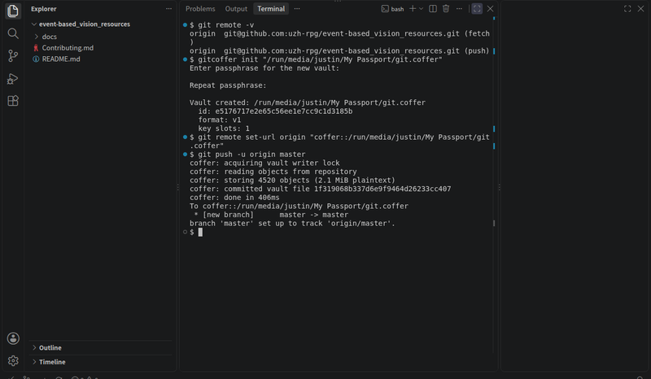
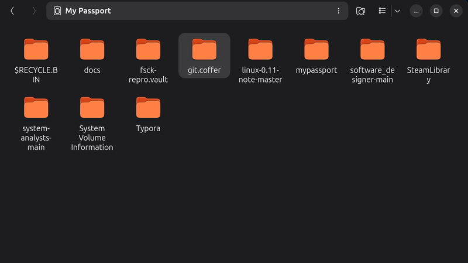
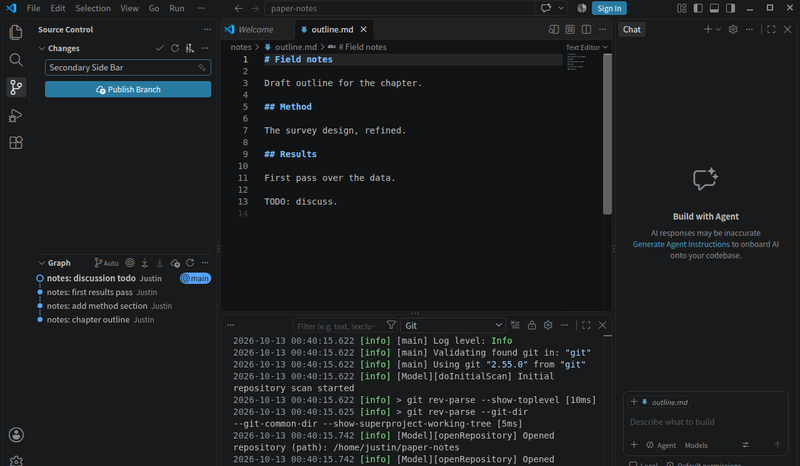
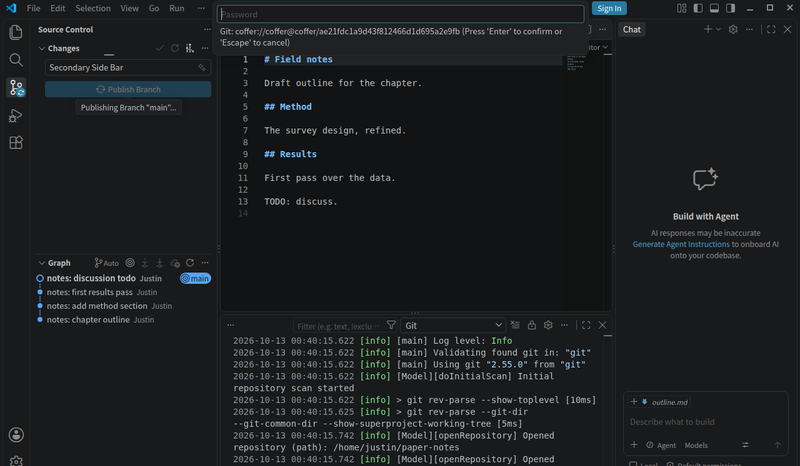
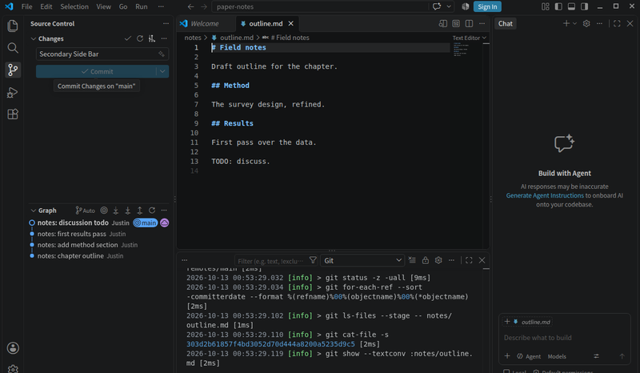
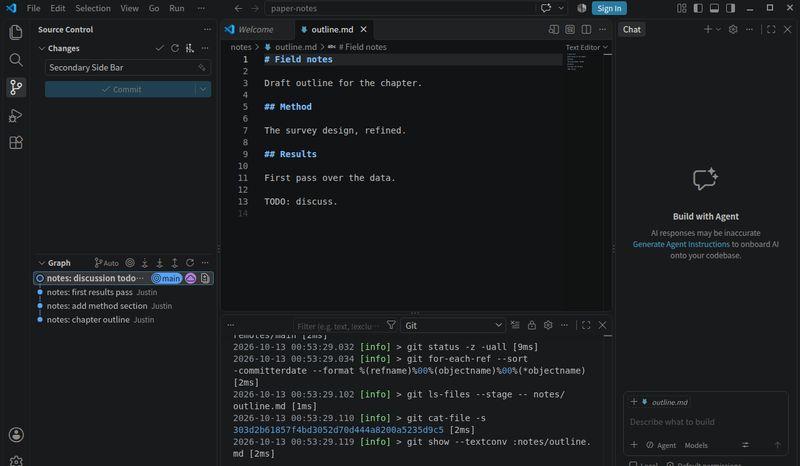

<div align="center">
  
</div>

<h1 align="center">GitCoffer</h1>

<p align="center">
  <strong>An encrypted git remote on your own disk.</strong><br>
  Push from any git client — including VSCode — straight into a
  password-protected vault on a second disk or USB drive.
</p>

<p align="center">
  
  &nbsp;
  
  &nbsp;
  
</p>

<p align="center">
  
</p>

---

Coffer turns any folder on a removable or second disk into an encrypted
git remote. `git push` works as always — but what reaches the disk is
encrypted. Without the passphrase, the files are noise. With it, the
whole repository — every branch, tag, and commit — is restored from the
vault alone.

This is the stable **1.0.0** release, tested across three operating
systems and real drives ([how Coffer is tested](#how-coffer-is-tested)).
The vault format is public and fixed, pinned by
[test vectors](docs/test-vectors.json).

> [!IMPORTANT]
> **New project? Safe to try.** Your working repository stays a normal
> git repository, plain and standard. The vault is only an encrypted
> copy of it on another disk. You can leave any time: push your
> repository to any host and delete the vault — or run
> `gitcoffer export-bundle` and get a normal git bundle file.

## Why

<p align="center">
  
</p>

- **No third party.** The remote is a folder — a USB stick, an
  external drive, a second disk. The code has no networking: no service
  sits between you and your data.
- **Encrypted at rest.** Everything is encrypted under your passphrase
  (Argon2id and XChaCha20-Poly1305). A changed byte fails the check, so
  damage cannot hide. Without the passphrase, the drive holds noise,
  not code.
- **Stock git, unchanged.** Coffer is a standard
  [git remote helper](docs/architecture.md). No special git, no
  wrappers, no server. If `git push` works, Coffer works — and so does
  the VSCode Sync button.
- **Works with or without a host.** A vault is enough on its own. If
  you already use GitHub or GitLab, you can keep using it and add the
  vault as a second remote for backups.
- **Single static binary.** No GPG, no FUSE, no drivers, no
  administrator rights. The vault is plain files, so exFAT and FAT32
  drives work fully.

## Install

You need git 2.30 or newer and the two GitCoffer binaries, `gitcoffer`
and `git-remote-coffer`, on `PATH`.

With a package manager (macOS / Linux):

```console
$ brew tap Ziqing7226/gitcoffer
$ brew install Ziqing7226/gitcoffer/gitcoffer
```

With scoop (Windows):

```powershell
scoop bucket add ziqing7226 https://github.com/Ziqing7226/scoop-bucket
scoop install gitcoffer
```

A winget entry (`winget install Ziqing7226.GitCoffer`) is in review.

Or download a release — Linux, Windows, macOS, amd64 or arm64 — from
the [releases page](https://github.com/Ziqing7226/GitCoffer/releases),
unpack, and put both binaries on `PATH` (no administrator rights
needed). Verify:

```console
$ gitcoffer version
gitcoffer v1.0.0
```

The install script, the PowerShell installer, building from source,
shell completion, and the macOS notes (Dock-launched apps, Gatekeeper)
are in the [user guide's Install section](docs/user-guide.md#install).

## Quick start

```console
$ gitcoffer init /mnt/usb/myproject.coffer
Enter passphrase for the new vault: ********
Repeat passphrase: ********
Vault created: /mnt/usb/myproject.coffer

$ git remote add origin coffer::/mnt/usb/myproject.coffer
$ git push -u origin main
Enumerating objects: 42, done.
Writing objects: 100% (42/42), done.
To coffer::/mnt/usb/myproject.coffer
 * [new branch]      main -> main
```

From then on, `git pull`, `git fetch`, and VSCode's Sync button work
against the vault. Git asks for the passphrase the usual way: in the
terminal, in VSCode's input box, or through a credential helper.

The vault path depends on where your drive lives:

- Linux: `/mnt/usb` in these examples is a placeholder. Desktop Linux
  mounts removable drives under `/run/media/<you>/<drive-label>` —
  `lsblk` shows yours.
- Windows: `git remote add origin coffer::D:\backups\myproject.coffer`
- macOS: `git remote add origin coffer::/Volumes/Backup/myproject.coffer`

Cloning on another machine needs three things: git, Coffer, and the
passphrase. That machine can even run a different system — hand the
drive to a colleague, and they clone it on Windows, Linux, or macOS:

```console
$ git clone coffer::/mnt/usb/myproject.coffer
```

### Nicer remote URLs

Vault paths get long. Git can rewrite them: one line tells git that
every URL starting with `usb://` means `coffer::` plus this folder —
your remotes stay short:

```console
$ git config --global url."coffer::/mnt/usb/".insteadOf "usb://"
$ git remote add origin usb://myproject.coffer
```

Git applies the rule on every use. Two notes:

- The rule lives on each machine, so a colleague needs the same line.
- When the drive's path changes (a new drive letter, a new mount
  point), you update this one line, and every clone follows.

## How it works

When git sees a remote like `coffer::/mnt/usb/myproject.coffer`, it runs
a small helper program, `git-remote-coffer`. On push, the helper
encrypts your objects and writes them into the vault. On fetch, it
decrypts them back. Git never sees the difference — so every git client
works, including VSCode.

The design is described in [docs/architecture.md](docs/architecture.md);
the vault layout is specified in [docs/format-spec.md](docs/format-spec.md).

## Moving an existing project onto a vault

No import, no conversion — a vault is just another remote.

Already have the project cloned (your current branch and tags):

```console
$ gitcoffer init /mnt/usb/myproject.coffer
$ git remote add vault coffer::/mnt/usb/myproject.coffer
$ git push vault --all     # every branch that exists in this clone
$ git push vault --tags    # every tag
$ git remote set-url origin coffer::/mnt/usb/myproject.coffer   # make it the default
```

The last line makes the vault your default. To keep using both, skip it:
`git push` goes to GitHub, `git push vault` goes to the vault — share on
GitHub, back up to the vault, from the same clone.

Everything on the old host, exactly as it is (all branches, tags, notes):

```console
$ git clone --mirror git@example.com:you/myproject.git
$ git push --mirror coffer::/mnt/usb/myproject.coffer
```

From then on, pushes go to the vault; cloning on another machine is one
command ([Quick start](#quick-start)). You can delete the old
repository once you are comfortable — the vault plus the passphrase
restores everything.

### If pull does nothing after the switch

After you point `origin` at the vault, the branch still tracks the old
remote, so `git pull` may do nothing and VSCode may show "Publish
Branch" again. Standard git, not a Coffer fault. The helper fixes this
by itself whenever it has work to do: after a push, or after a fetch
that transfers something, it attaches the branch to the vault remote
(`main` to `origin/main`) and prints what it did. If your pull still
does nothing — a fetch with nothing to transfer never triggers it —
fix it once:

```console
$ git push origin main                                # or, manually:
$ git branch --set-upstream-to=origin/main main   # use your branch name
```

Branch names that differ, and the full story, are in the
[user guide's troubleshooting table](docs/user-guide.md#troubleshooting).

### From GitHub to a vault

The same steps, done for real inside the editor. One terminal session
against a repository cloned from GitHub —
[event-based_vision_resources](https://github.com/uzh-rpg/event-based_vision_resources)
by UZH's Robotics and Perception Group, thank you for the public work:



Top to bottom: `git remote -v` against GitHub, `gitcoffer init`, one
`set-url` moving `origin`, a push — 4,520 objects in 557 ms.

On the drive: one new folder. Nothing else changed.



## The coffer CLI

| Command | Purpose |
|---|---|
| `gitcoffer init <dir>` | create a new vault |
| `gitcoffer status <dir>` | inspect a vault (prompts for the passphrase to show refs and packs) |
| `gitcoffer rekey <dir>` | change the passphrase (data is never re-encrypted) |
| `gitcoffer key add / remove / list` | manage key slots; optional key-file second factor |
| `gitcoffer gc [--prune] <dir>` | report reclaimable space, or reclaim it with `--prune`; `--repack` also rebuilds the packs so deleted history physically leaves the disk |
| `gitcoffer fsck <dir>` | verify every structure of the vault |
| `gitcoffer doctor <dir>` | check the environment and the vault |
| `gitcoffer check <dir>` | probe a vault from a script — exit 0 opens, 1 vault that does not open, 100 not a vault |
| `gitcoffer move <dir> <new-path>` | relocate a vault directory to another disk or folder |
| `gitcoffer migrate <dir>` | convert a v1 vault to format v2 in place (one-way: older binaries then refuse it) |
| `gitcoffer backoff <on/off> <dir>` | toggle the interactive wrong-passphrase delay (gitcoffer's own prompts; needs the passphrase) |
| `gitcoffer export-bundle <dir> <file>` | export the vault as a plain git bundle — the exit path |
| `gitcoffer version [--json]` | print the build version (optionally as JSON) |
| `gitcoffer completion <shell>` | print a completion script for bash, zsh, fish, or powershell |
| `gitcoffer help [<command>]` | print detailed usage for one command, or for all of them |

Please run `gitcoffer fsck` on your vault from time to time — after a
big push, or once a month. It checks every part of the vault, so a
failing drive is caught early, while recovery is still easy.

Full walkthrough — keys and recovery, maintenance, troubleshooting:
[docs/user-guide.md](docs/user-guide.md).

## Inside VSCode

Nothing new to learn: the vault is just a remote. Publishing asks for
the passphrase once, through git's own prompt; after that, Sync, the
incoming/outgoing counters, and the commit graph read from the
encrypted vault. These screenshots show a real vault on a USB drive,
pushed from the editor itself:

<table>
  <tr>
    <td width="50%">
      <br>
      <em>Publish Branch — one button, as with any remote</em>
    </td>
    <td width="50%">
      <br>
      <em>The passphrase arrives through git's native credential prompt</em>
    </td>
  </tr>
  <tr>
    <td>
      <br>
      <em>In sync: 0↓ 0↑, origin/main current</em>
    </td>
    <td>
      <br>
      <em>The built-in commit graph, remote refs included</em>
    </td>
  </tr>
</table>

## Security scope

<p align="center">
  
</p>

Coffer protects **repository data at rest on the remote medium**.

| In scope | Out of scope |
|---|---|
| Lost, stolen, or bit-by-bit copied drives | A host compromised *while* the vault is in use |
| Failure of the working disk — the vault is a complete backup | A forgotten passphrase — there is no recovery, by design |
| Damaged or tampered vault files — every file is verified | Hiding vault metadata, such as file count and approximate sizes |

The full analysis is in [docs/threat-model.md](docs/threat-model.md).

## Choosing an approach

Which copy needs encrypting? Usually not the server — it sits in a
protected rack. The weak copy is the one that leaves your machine: the
portable drive that travels in bags and one day gets lost.

Four good ways exist to protect that copy:

- Encrypt single files inside the repository
- Put a bare repository on an encrypted volume
- Archive the repository with a backup tool (restic, Borg, Kopia)
- **Use an encrypted remote helper** — the whole remote is encrypted,
  `git push` stays one step on every platform, nothing to mount or run.
  This is Coffer.

A vault is just encrypted files, so it can even live on storage you
don't fully trust — a NAS, an office share, a mounted cloud folder.
The people who manage that storage cannot read your code.

When each fits, and Coffer's honest limits, are set out in
[docs/choosing-an-approach.md](docs/choosing-an-approach.md).

## How Coffer is tested

Claims are cheap. Everything below can be checked from this
repository's CI logs and release archives — including what was *not*
tested by hand.

- **Every change runs the full test suite** on Linux, Windows, and
  macOS. The tests push and clone with real git, kill the helper
  mid-push and require the vault to recover, and corrupt vault files
  on purpose to prove the failure is loud — never silent.
- **Seven release candidates were tested on real drives.** From rc.4
  on, each was installed from its published archive and run through
  the full checklist on Windows (NTFS, exFAT, FAT32) and Linux
  (FAT32, exFAT) media — including one system writing a vault and
  another reading it back. macOS was never hand-tested on Apple
  hardware: CI plus a specialist review, no device claims. **v1.0.0
  carries rc.7's code unchanged; only documentation differs.**
- **Independent review rounds** covered the cryptography, the Go
  security, and the git protocol and backup behavior. Every finding
  became a fix with a test. These are agent-run reviews, not a paid
  third-party audit.
- **The format is pinned, not promised**: a written specification and
  public [test vectors](docs/test-vectors.json) let any implementation
  check a vault byte-for-byte. `gitcoffer export-bundle` writes a
  plain git bundle — the exit path is built in.

Boundaries — LFS content, visible metadata, tampering — are stated in
the [threat model](docs/threat-model.md) and the
[support matrix](docs/support-matrix.md).

## Documentation

| Document | Purpose |
|---|---|
| [User guide](docs/user-guide.md) | install, everyday use, keys and recovery, maintenance |
| [Architecture](docs/architecture.md) | design decisions, components, protocol flows |
| [Vault format specification](docs/format-spec.md) | normative on-disk format — build against this |
| [Support matrix](docs/support-matrix.md) | tested configurations and explicit boundaries |
| [Threat model](docs/threat-model.md) | what Coffer does and does not protect |
| [Choosing an approach](docs/choosing-an-approach.md) | the four ways to encrypt an offsite copy, and when each fits |
| [Development plan](docs/development.md) | stack, phases, testing strategy, conventions |
| [Contributing](CONTRIBUTING.md) | repository rules and how to contribute |

## Contributing

- If Coffer works for you, a star helps others find it.
- Issues and pull requests are welcome — holes in the threat model,
  gaps in the guide, portability reports, and fixes all count.
- All artifacts in this repository are written in English; see
  [CONTRIBUTING.md](CONTRIBUTING.md).

## License

[MIT](LICENSE)
